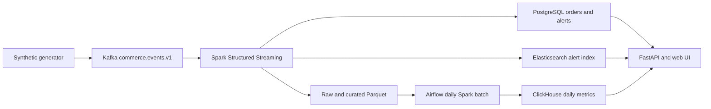

# ADR 0001 — Smallest end-to-end commerce risk platform

Status: accepted for the local development slice (2026-10-24).

## Decision

One versioned JSON envelope carries order, payment, inventory, shipment, and application events in a single Kafka topic. A Spark Structured Streaming job validates and deduplicates by `(tenant_id, event_id)` with a 48-hour event-time watermark. It writes immutable raw Parquet and curated Parquet, then uses idempotent PostgreSQL upserts for operational state and alerts. PostgreSQL is also the control plane. ClickHouse is the local analytical store because it can query large columnar datasets without a paid cloud account. Elasticsearch indexes alert investigation documents; PostgreSQL remains the authoritative source if indexing fails. FastAPI serves a tenant-scoped API and a small browser UI. Airflow invokes a daily Spark batch reconciliation and analytics publication task.

The development deployment is one Docker Compose host. It is **not** a secure production topology. Production needs TLS, a secret manager, private networks, Kafka ACLs, PostgreSQL row-level security as defense in depth, Elasticsearch authorization, backups, service identities, and horizontal worker sizing.

## Data flow

## Tenant boundary

Every event has a tenant ID in its key and payload. The generator uses `tenant_id:entity_id` as the Kafka key. The processor checks registered tenant and market IDs before processing. Operational tables use composite tenant keys. Every API query receives tenant context from a verified bearer token or hashed API key; client-supplied tenant IDs are ignored. Search and analytics queries always include the authenticated tenant. A cross-tenant API test is mandatory before release. Kafka topic ACLs and physical tenant separation are planned deployment controls; the shared local broker does not provide them.

## Data model

PostgreSQL owns `tenants`, `markets`, `users`, `api_keys`, versioned `tenant_config` and `market_rules`, `processed_events`, `orders`, `alerts`, `audit_logs`, `usage_daily`, and `api_rate_windows`. `orders`, `alerts`, and processed events use tenant-aware keys. ClickHouse has a latest-version `order_facts` table and versioned `daily_metrics` keyed by tenant, day, market, and currency. Elasticsearch indexes alerts under deterministic `tenant_id:alert_id` document IDs. Raw and curated lake layers are Parquet files; raw is replayable and curated is a derived view.

## Repository structure

| Path | Purpose |
|---|---|
| `app/`, `web/` | Contract, authentication, operational store, API, generator, browser UI |
| `jobs/`, `dags/` | Spark stream, batch reconciliation, Airflow schedule |
| `sql/`, `schemas/` | Store initialization and versioned event schema |
| `tests/` | Contract checks and opt-in live isolation/replay checks |
| `docs/` | Architecture, operations, load-test evidence |

## Data contract

`schema_version` is `1`; required fields are `event_id` (UUID), `tenant_id` (slug), `market` (ISO country code), `event_type`, `occurred_at` (UTC ISO 8601), and object `payload`. The machine-readable contract is [`schemas/event-v1.schema.json`](../schemas/event-v1.schema.json). An `order` payload has `order_id`, `amount`, `currency`, and `email`; payment has `order_id`, `status`, `amount`; shipment has `order_id`, `status`, `eta_at`; inventory has `sku`, `available`; application has `level`, `message`. Unknown additive payload fields are allowed. Breaking changes require a new schema version and a parallel consumer rollout. Invalid records go to a dead-letter Parquet path with validation reason. Late records beyond 48 hours are retained in raw storage and reconciled in batch.

## Idempotency and recovery

Operational writes use event IDs and tenant IDs as unique keys. Alert IDs are deterministic hashes of tenant, order, and rule. Spark checkpoints control Kafka offsets. Replaying from earliest can reprocess rows but cannot create duplicate business records. The batch job recomputes aggregates from the curated lake and replaces a tenant/day slice in ClickHouse. Search indexing is retryable from PostgreSQL. Since Parquet and PostgreSQL are separate sinks, failures can leave a partial microbatch; replay and reconciliation repair it. Exactly-once across all sinks is not claimed.

## Why these components

Storm and Flume add operational cost without improving the first slice. Add Storm only for a measured subsecond rules requirement and Flume only for a legacy log source. GCS, Dataproc, and BigQuery are optional adapters requiring explicit cloud approval. A load-test profile is separate from the tiny default generator.

## Phases

1. Contract, local stack, event generator, streaming rules, operational API and UI.
2. Spark batch reconciliation, Airflow scheduling, ClickHouse analytics, replay checks.
3. Tenant administration, quotas, audit, deletion, observability, backup, hardening.
4. Optional cloud and legacy integrations after measured need and approval.

## Cost and sizing

Local development should budget roughly 8–12 GiB RAM and 4 CPU cores for Kafka, Spark, PostgreSQL, ClickHouse, Elasticsearch, Airflow, and API together. These are estimates, not measurements. Production cost drivers are retained Kafka partitions, Spark executor memory, search index size, analytical storage, backups, and network egress. Self-hosted software avoids license fees for Kafka, Spark, PostgreSQL, ClickHouse, and Airflow, but compute and operations are still paid. Elasticsearch self-managed free features are governed by Elastic's license, not Apache 2.0.
